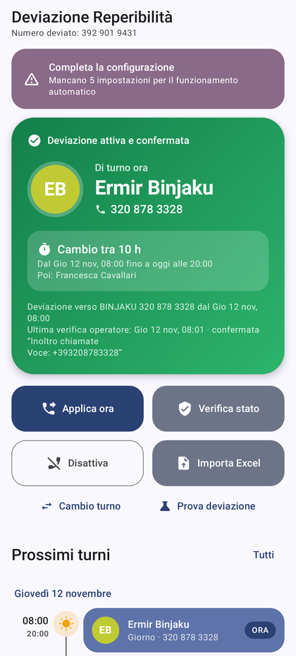
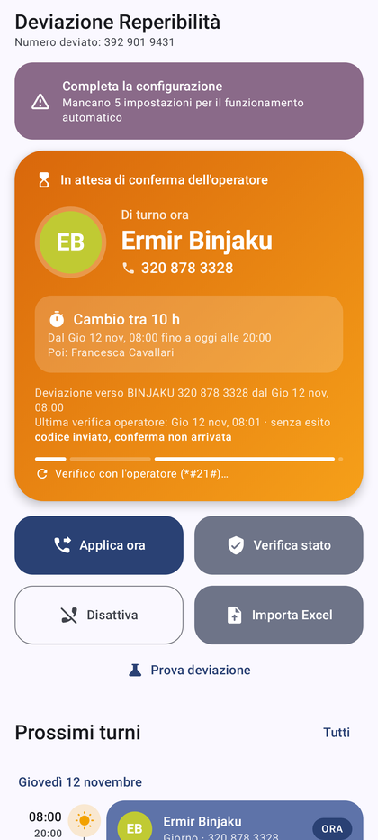
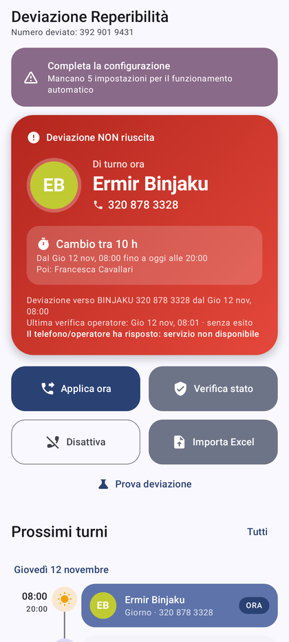
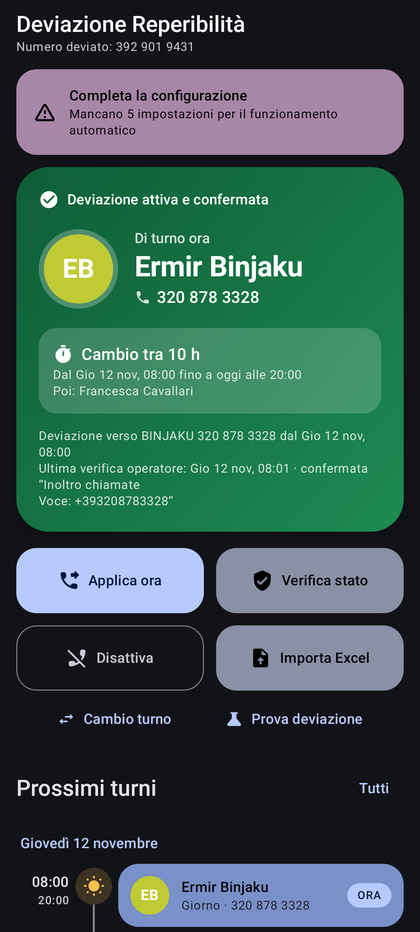
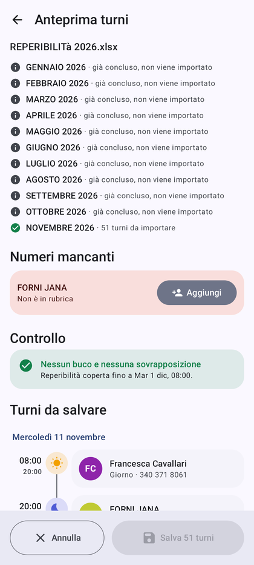
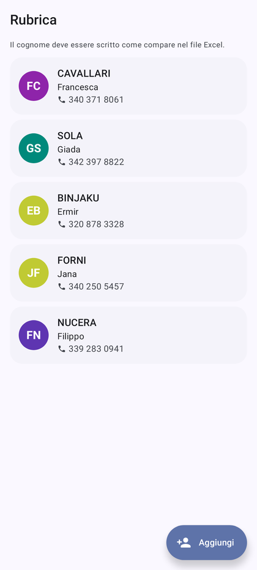
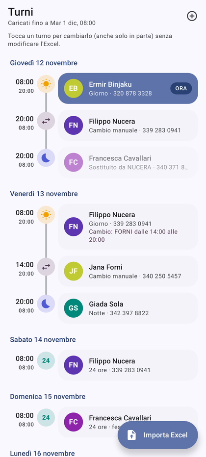
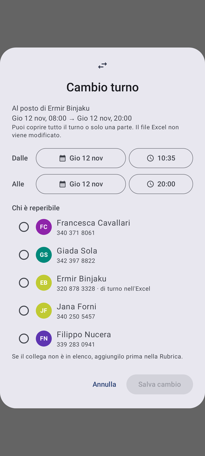

# 📞 Deviazione Reperibilità

App Android personale che **devia in automatico le chiamate del telefono di reperibilità (392 901 9431) verso l'infermiere di turno**, leggendo i turni dal file Excel mensile. Non serve fare niente a mano: a ogni cambio turno l'app imposta la deviazione, chiede conferma all'operatore e, se qualcosa va storto, suona come una sveglia.

- Kotlin + Jetpack Compose, Material 3 con colori dinamici (Material You), tema chiaro/scuro
- Android 10 o successivo (minSdk 29), target Android 17 (API 37)
- Nessun server: turni, rubrica e registro restano **solo sul telefono** (Room + DataStore)

<p>




</p>
<p>





</p>

> ⚠️ La repository contiene i numeri della rubrica iniziale e un file Excel di prova con i nomi dei colleghi: tienila **privata** (GitHub → *Settings* → *General* → *Danger Zone* → *Change repository visibility*).

---

## Come funziona

| Cosa | Come |
|---|---|
| **Attivare la deviazione** | codice `**21*NUMERO#` (deviazione incondizionata) |
| **Disattivare** | codice `##21#` |
| **Verificare** | codice `*#21#`: l'app legge il numero restituito dall'operatore e lo confronta con quello atteso |

1. L'app invia il codice con `TelephonyManager.sendUssdRequest` (permesso *Telefono*) e legge la risposta dell'operatore.
2. Se non funziona, usa il metodo di riserva: una "chiamata" al codice (`ACTION_CALL` con `#` → `%23`, o `TelecomManager.placeCall` quando l'app è in background). In questo caso la risposta compare in un popup di Android e l'app non può leggerla.
3. Dopo l'attivazione verifica con `*#21#`. Se entro **2 minuti** l'operatore non conferma, oppure se l'invio fallisce, parte l'**allarme**.

### Turni dal file Excel
Un foglio per mese (es. `NOVEMBRE 2026`). Righe = infermieri (`COGNOME NOME`), colonne = giorni del mese. La lettura si ferma alla `LEGENDA`.

| Codice | Orario (fuso Europe/Rome) |
|---|---|
| `G` / `GD` | 08:00 → 20:00 |
| `N` / `ND` | 20:00 → 08:00 del giorno dopo |
| `24H` / `24HD` | 08:00 → 08:00 del giorno dopo |
| altro o vuoto | ignorato (es. `CORSO`, `LIBERO`) |

La `D` finale indica i festivi: gli orari restano gli stessi. Nel file 2026, a giugno, ci sono `GD` e `ND`. Il cambio dell'ora legale è gestito: il 24H del 24 ottobre 2026 dura 25 ore reali.

Prima di salvare, l'app mostra un'**anteprima** che segnala:
- i **buchi** (per esempio "mer 18 nov: dalle 08:00 alle 20:00 nessuno di turno"). Puoi salvare comunque e ricaricare il file corretto più tardi: i mesi reimportati vengono sostituiti. Durante un buco resta attiva l'ultima deviazione e arriva una notifica;
- le **sovrapposizioni**: la deviazione va a chi ha iniziato il turno per ultimo;
- i **nomi assenti dalla rubrica**: l'app chiede il numero prima di salvare.

I mesi già conclusi non vengono importati.

---

## 1. Firma dell'APK (una volta sola)

Android installa gli aggiornamenti solo se l'APK è firmato sempre con la **stessa chiave**. La chiave (*keystore*) **non è nella repository**: va salvata nei GitHub Secrets.

### Se hai ricevuto il keystore già pronto
Hai tre file: `deviazione-release.jks`, `keystore-base64.txt` e `password.txt`.

1. Su GitHub apri la repository → **Settings** → **Secrets and variables** → **Actions** → **New repository secret**.
2. Crea questi 4 secrets:

| Nome | Valore |
|---|---|
| `KEYSTORE_BASE64` | tutto il contenuto di `keystore-base64.txt` (una riga lunga) |
| `KEYSTORE_PASSWORD` | la password in `password.txt` |
| `KEY_ALIAS` | `deviazione` |
| `KEY_PASSWORD` | la stessa password |

3. **Conserva `deviazione-release.jks` e la password** in un posto sicuro (per esempio Google Drive privato o un password manager). Se li perdi, per aggiornare l'app dovrai disinstallarla e reinstallarla, perdendo rubrica e registro.

### Se vuoi creare un keystore nuovo
Serve Java (comando `keytool`):
```bash
keytool -genkeypair -v -keystore deviazione-release.jks -storetype PKCS12 \
  -alias deviazione -keyalg RSA -keysize 4096 -validity 36500 \
  -dname "CN=Deviazione Reperibilita, O=Uso personale, C=IT"
```
Poi convertilo in testo per il secret `KEYSTORE_BASE64`:
- **Linux**: `base64 -w0 deviazione-release.jks > keystore-base64.txt`
- **macOS**: `base64 -i deviazione-release.jks -o keystore-base64.txt`
- **Windows (PowerShell)**: `[Convert]::ToBase64String([IO.File]::ReadAllBytes("deviazione-release.jks")) | Out-File keystore-base64.txt`

---

## 2. Compilare l'APK con GitHub Actions

Non serve Android Studio. A ogni `push` su `main` il workflow **Compila APK** (`.github/workflows/build.yml`):
1. esegue i test (lettura del file Excel reale, calcolo dei turni, buchi e sovrapposizioni, risposte dell'operatore);
2. compila l'APK release **firmato**;
3. lo pubblica come *artifact* `DeviazioneReperibilita-N` (conservato 90 giorni).

Per avviarlo a mano: scheda **Actions** → **Compila APK** → **Run workflow**.
Se i secrets non ci sono, il workflow esegue comunque test e compilazione, poi si ferma con il messaggio "Secrets mancanti" senza pubblicare l'APK.

---

## 3. Installare l'APK sul Samsung

1. Dal telefono, nel browser con l'accesso a GitHub fatto: repository → **Actions** → l'ultima esecuzione verde ✅ → in fondo, **Artifacts** → `DeviazioneReperibilita-N`. Si scarica un file **.zip**.
2. Apri **I miei file** → *Download* → tocca lo zip → **Estrai**. Ottieni `DeviazioneReperibilita-N.apk`.
3. Tocca l'APK. La prima volta Android chiede di consentire **"Installa app sconosciute"** per *I miei file*: attivalo e torna indietro.
4. Se Play Protect avvisa che l'app è sconosciuta: **Altri dettagli** → **Installa comunque**.
5. **Aggiornamenti**: installa il nuovo APK sopra il vecchio. Turni, rubrica e registro restano.

---

## 4. Primo avvio (importante)

Apri **Impostazioni** nell'app e porta tutte le voci a ✅:

1. **Permesso Telefono**: per inviare i codici e scegliere la SIM.
2. **Notifiche**.
3. **Allarme a tutto schermo**: per vedere l'allarme anche a telefono bloccato.
4. **Sveglie e promemoria** (allarmi esatti): su Android 13 e successivi è già attivo.
5. **Nessuna ottimizzazione batteria**: tocca *Attiva* e conferma **Consenti**.
6. **Samsung, "App mai in sospensione"**:
   - Impostazioni → **Assistenza dispositivo e batteria** → **Batteria** → **Limiti utilizzo in background** → **App mai in sospensione** → **+** → *Deviazione Reperibilità*;
   - poi Impostazioni → **App** → *Deviazione Reperibilità* → **Batteria** → **Senza restrizioni**;
   - controlla che l'app **non** sia tra le "App in sospensione" o "in sospensione profonda".
7. **Doppia SIM**: scegli la SIM del 392 901 9431.
8. **Importa il file Excel**: pulsante *Importa Excel*, oppure dalla mail apri l'allegato con **Apri con** / **Condividi** → *Deviazione Reperibilità*.
9. Fai **Prova allarme** e **Prova deviazione**: chiama il 392 901 9431 da un altro telefono e conferma se ha squillato il collega di turno.

---

## Uso quotidiano

**Schermata Stato**
- Card **verde**: deviazione attiva e confermata dall'operatore.
- Card **arancione**: in corso, oppure in attesa della conferma dell'operatore.
- Card **rossa**: errore. Tocca *Applica ora*, oppure *Riprova* nella notifica.
- Card **grigia**: automatismo sospeso o deviazione disattivata.

La card mostra chi è di turno (nome, iniziali, numero), da quando e fino a quando, il conto alla rovescia al prossimo cambio e l'esito dell'ultima verifica dell'operatore.

**Pulsanti**
- **Applica ora**: invia subito la deviazione del turno in corso e riattiva l'automatismo.
- **Verifica stato**: `*#21#`; mostra il numero restituito dall'operatore e lo confronta con quello atteso.
- **Disattiva**: `##21#`; sospende l'automatismo finché non premi *Applica ora*.
- **Importa Excel**: carica il file dei turni.

**Altre schede**: *Turni* (timeline con ☀️ giorno, 🌙 notte, **24** ore, ⇄ cambi manuali), *Rubrica* (aggiungi, modifica, elimina, importa dai contatti), *Registro* (ogni deviazione con data, ora, numero ed esito).

**Notifiche**
- Fissa e silenziosa: chi è di turno e fino a quando.
- A ogni cambio: "Deviazione attiva → COGNOME (numero) fino alle HH:MM", con ✓ se l'operatore ha confermato.
- Errore (alta priorità, con suono): "ATTENZIONE: deviazione NON riuscita" con il pulsante **Riprova**.

**Allarme**
- Schermata rossa a tutto schermo, suono forte in loop sul canale *sveglia* (suona anche in silenzioso e con Non disturbare) e vibrazione continua.
- Pulsanti **Riprova deviazione** e **Ho visto, spegni**.
- Se non lo spegni, si ripete **ogni 5 minuti** finché la deviazione non risulta riuscita.

**Cambi turno all'ultimo momento** (senza toccare il file Excel)
- **Stato → Cambio turno**: scegli chi copre e l'orario (di solito da adesso alla fine del turno). La deviazione passa subito al nuovo collega e alla fine torna da sola a quello previsto dall'Excel.
- **Turni**: tocca un turno per sostituirlo tutto o solo in parte (per esempio dalle 14 alle 20). Con **⊕** in alto aggiungi un turno nuovo, utile anche per coprire un buco.
- Nella timeline i cambi hanno l'icona ⇄ e il turno sostituito diventa grigio. Tocca un cambio per annullarlo.
- Se reimporti l'Excel, i cambi fatti a mano restano validi. Nell'anteprima puoi scegliere di eliminarli, se il nuovo file li contiene già.
- Ogni cambio viene scritto nel registro.

**Widget**: tieni premuto sulla schermata Home → *Widget* → *Deviazione Reperibilità*.

**Comportamento automatico**
- Due turni consecutivi con lo stesso numero non rifanno la deviazione.
- Dopo il riavvio del telefono, un cambio di ora o di fuso, o un aggiornamento dell'app, gli allarmi vengono riprogrammati.
- Se un cambio turno è stato saltato (telefono spento, app bloccata), la deviazione corretta viene applicata subito al riavvio o all'apertura dell'app.

---

## Domande frequenti

**La card resta arancione e dopo 2 minuti suona l'allarme, anche se la deviazione funziona.**
Alcuni operatori o telefoni non restituiscono la risposta all'app, e allora si usa il metodo di riserva. Fai una **Prova deviazione**: se rispondi "Sì, è arrivata", lo stato diventa confermato. Se succede sempre, disattiva in Impostazioni *"Allarme se l'operatore non conferma"*: l'allarme suonerà solo in caso di errore vero.

**L'operatore rifiuta il codice.**
Prova ad attivare *"Usa il prefisso +39 nel codice"* nelle Impostazioni.

**Costi**: le chiamate deviate vengono addebitate alla SIM che devia, secondo il suo piano tariffario (di solito rientrano nei minuti inclusi).

**Il mese nuovo**: quando arriva il file del mese, importalo. Se i turni caricati finiscono, l'app avvisa con una notifica e lascia attiva l'ultima deviazione.

---

## Per chi sviluppa

```
app/src/main/java/it/reperibilita/deviazione/
├── data/          Room (turni, colleghi, registro) e DataStore (impostazioni e stato)
├── dominio/       logica pura: tipi di turno, calendario, nomi e numeri, situazione attuale
├── excel/         lettore .xlsx senza dipendenze (zip + SAX), lettura turni, buchi/sovrapposizioni, anteprima
├── telefonia/     invio dei codici MMI (USSD + riserva) e interpretazione delle risposte dell'operatore
├── servizio/      Motore (applica/verifica/disattiva), servizio in primo piano, AlarmManager, receiver
├── allarme/       servizio dell'allarme sonoro e schermata a tutto schermo
├── notifiche/     canali e notifiche
├── widget/        widget Glance
└── ui/            schermate Compose
```

In locale, con l'Android SDK:
```bash
./gradlew testDebugUnitTest     # test (Excel reale, logica, avvio dell'app con Robolectric)
./gradlew assembleDebug         # APK di debug
```
Per una release firmata in locale crea `keystore.properties` (è ignorato da git) con `KEYSTORE_FILE`, `KEYSTORE_PASSWORD`, `KEY_ALIAS`, `KEY_PASSWORD`.
